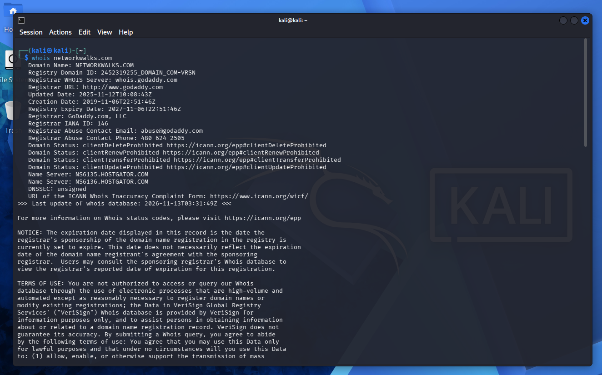
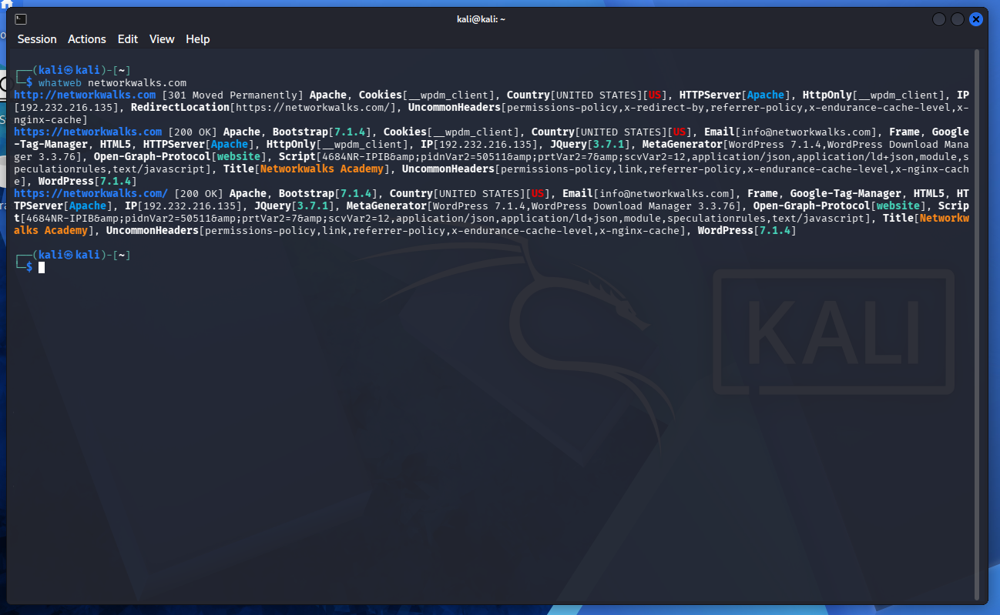
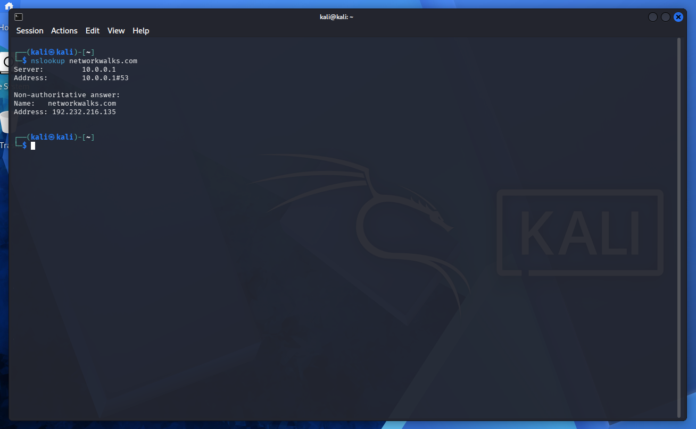
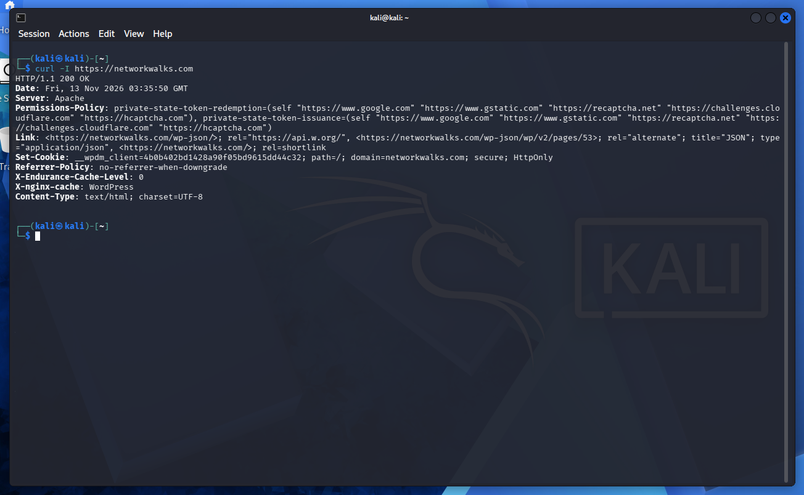
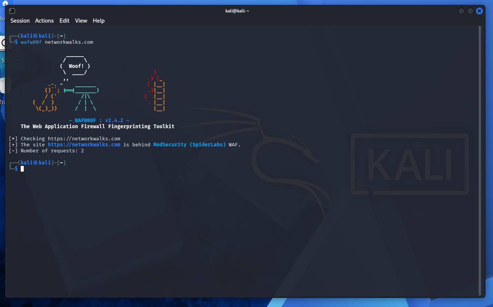
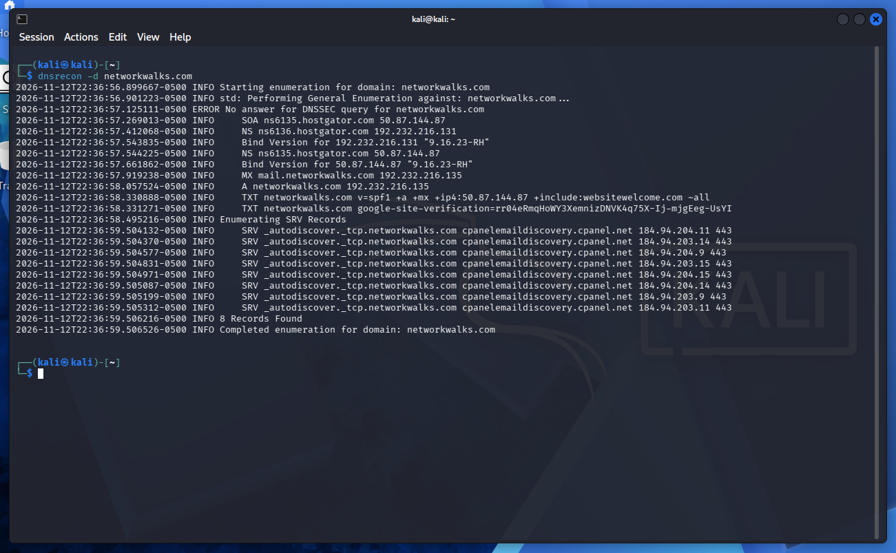
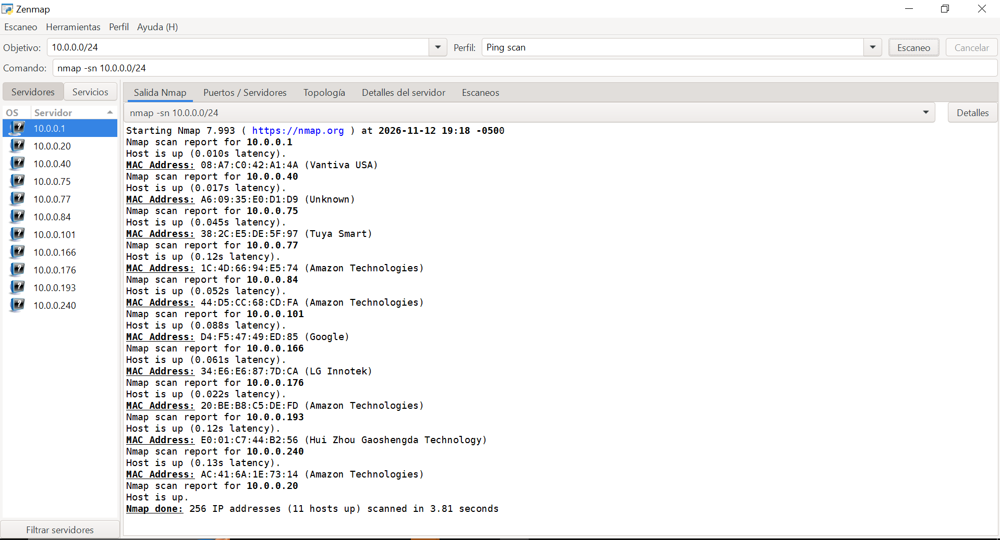
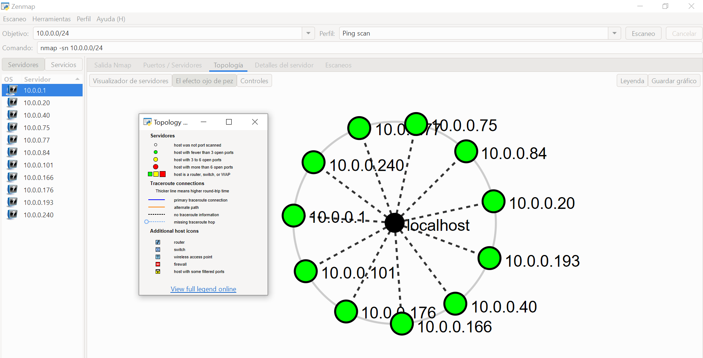

# PENETRATION TESTING REPORT
## FOOTPRINTING & NETWORK SCANNING PHASES
W2-PM-FINAL | CYBERSECURITY |  NETWORKWALKS

| Field | Details |
|---|---|
| **Pentester Name** | Jennifer Giraldo |
| **Program/Batch** | B084-Networkwalks |
| **Date** | 12 November 2026 |
| **Modules Completed** | W2-PM1 (Multiple Kali Tools)   W2-PM5 (Zenmap Scanning) |
| **Client/Target** | 1. Networkwalks (secured written permission)   2. My own local LAN Network |
| **Permission Secured from Client?** | Yes |
| **Phases Covered** | **Phase 1:** Reconnaissance & Footprinting   **Phase 2:** Scanning & Network Discovery   **Phases 3–5:** In Progress |

## 1. Liability Disclaimer
I have performed these activities only on the systems & devices where I had secured written permission or the devices/systems that I own myself. All these materials are for education and research purpose only. Do not use anything from here to break the law. The instructor, the authors and Networkwalks are not responsible for what you do with this knowledge. Every action you take is your own responsibility. Misuse can lead to criminal charges, heavy fines, loss of your job and a permanent record. In most countries unauthorised access is a crime even when nothing is damaged.

## 2. Introduction
This report covers footprinting the networkwalks.com domain using multiple Kali Linux tools (W2-PM1) and scanning my own local network with Zenmap (W2-PM5). One module covers the footprinting phase and the other covers the scanning phase, so together they show how an attacker moves from gathering public information to mapping live hosts on a network. It is the Week 2 part of my ongoing internship program at Networkwalks.
All commands were run in Kali Linux (footprinting) and on a Windows PC with Zenmap installed (scanning). Every step below includes the exact command used, the result I observed, a screenshot as evidence, and a short note on why the finding matters from an attacker's point of view.

## 3. Tools Used
The table below lists each tool used in this report and its purpose.

| Tool | Purpose |
|---|---|
| Kali Linux & Windows | Operating systems used for reconnaissance activities |
| WHOIS | Find domain registration details (owner, dates, name servers) |
| WhatWeb | Fingerprint web technologies (server, CMS, plugins, IP) |
| nslookup | Resolve the domain name to its IP address using DNS |
| curl -I | Read the HTTP response headers of the website |
| wafw00f | Detect whether a Web Application Firewall protects the site |
| dnsrecon | Enumerate DNS records (NS, MX, SPF, TXT, SRV) |
| Zenmap (Nmap GUI) | Scan the local subnet to find live hosts, IPs and MAC addresses |
| Windows CMD | Local IP and MAC address identification |

## 4. Activities Performed
### 4.1 Footprinting & Reconnaissance

I performed reconnaissance against the networkwalks.com domain using six Kali Linux tools: WHOIS, WhatWeb, Nslookup, Curl, Wafw00f and DNSRecon. Each tool was used to collect a different type of information about the target.
First, I used WHOIS to obtain publicly available domain registration information and identify the domain’s name servers. The results provided information about the domain registration and hosting infrastructure.
It was also found that DNSSEC is not enabled for the domain, meaning it lacks this additional layer of authentication.

I then used WhatWeb to identify technologies used by the website. The results identified WordPress 7.1.4, jQuery 3.7.1 and WP Download Manager 3.3.76, along with other information exposed by the website. These versions can be investigated to determine whether they have any known vulnerabilities.
The server returns a 301 Moved Permanently response, redirecting HTTP to HTTPS. However, the redirect alone does not guarantee that all communication is secure.
The __wpdm_client cookie uses the HttpOnly attribute, which prevents it from being accessed by browser-side JavaScript.
Using Nslookup, I resolved the domain name to its IP address. The provided result identified 192.232.216.135.
I used Curl with the -I option to inspect the HTTP response headers. This provided additional information about the web application and exposed the WordPress REST API endpoint /wp-json/.
Also, the security headers Permissions-Policy and Referrer-Policy were identified.
Next, I used Wafw00f to determine whether a Web Application Firewall was protecting the website. The result identified ModSecurity (SpiderLabs).
Finally, I used DNSRecon to enumerate DNS records. The results provided information relating to name servers, mail servers, SPF/TXT records, service records and DNS software information.
Two HostGator nameservers (ns6135 and ns6136) were identified, and BIND version 9.16.23-RH was reported.

### 4.2 Network Scanning with Zenmap
For the second activity, I used Zenmap to perform network discovery on my local network. The practical required me to identify my local IP address and subnet, discover live hosts, identify their IP and MAC addresses, and generate a network topology.
I first used the Windows ipconfig command to identify my local IP address and LAN subnet. I then entered the subnet into Zenmap and selected Ping Scan to identify active hosts.
The Ping Scan identified eleven live hosts on my local network.

The scan provided IP and MAC addresses for the discovered devices. This information was used to analyze network visibility and generate a basic network topology.

For privacy and security reasons, device identifiers have been anonymized in this public report.
      
After completing the scan, I opened the Topology section in Zenmap, enabled the legend and saved the network topology in PDF format as required by the practical task.

## 5. Risk Analysis / Impact
Based on the information collected during the footprinting and network scanning activities, the following findings were identified:

| # | Risk / Finding | Evidence / Observation | Potential Impact | Risk Level |
|---|---|---|---|---|
| 1 | Web technology versions exposed | WhatWeb identified WordPress 7.1.4 and WP Download Manager 3.3.76 | Exposed versions may help attackers identify known vulnerabilities affecting the software. | 🟠 Medium |
| 2 | DNSSEC not enabled | WHOIS reported DNSSEC: unsigned | Without DNSSEC, DNS responses lack DNSSEC-based authenticity verification, potentially increasing exposure to DNS spoofing attacks. | 🟠 Medium |
| 3 | Security headers not observed | Curl -i response did not include HSTS or Content-Security-Policy headers. | Missing protections may increase exposure to certain downgrade or content-injection risks. | 🟢 Low |
| 4 | Server IP address identifiable | Nslookup resolved the domain to 192.232.216.135. | May assist technology fingerprinting and further enumeration. | 🟢 Low |
| 5 | WAF technology identifiable | Wafw00f identified ModSecurity (SpiderLabs). | Reveals information about the web application's security architecture. | 🟢 Low |
| 6 | DNS infrastructure information exposed | DNSRecon identified DNS, mail and service-related records. | DNS information can help build a broader infrastructure profile. | 🟢 Low |
| 7 | Multiple live hosts visible on local network | Zenmap identified eleven live hosts in the example network. | Unknown or unauthorized devices may potentially be present on a network. | 🟠 Medium |

**Risk level key:** 🔴 Critical | 🟠 Medium | 🟢 Low

The risks above are observations from the footprinting and scanning exercises, not confirmed vulnerabilities.

The practical exercises primarily involved information gathering and host discovery. No exploitation or vulnerability validation was performed as part of these two modules.

Therefore, the presence of information such as a software version, IP address or DNS record does not by itself mean that the system is vulnerable. Further authorized security testing would be required to confirm any actual vulnerability.

## 6. Recommendations
Based on the observations from these activities, I recommend the following security improvements:

1. **Keep software updated**  
   Regularly update WordPress, plugins, and server software to address known vulnerabilities.

2. **Enable DNSSEC**  
   Improve DNS security by enabling DNS response authentication and integrity verification.

3. **Implement HTTP security headers**  
   Review and configure HSTS and Content-Security-Policy (CSP) to strengthen browser security.

4. **Review exposed software versions**  
   Minimize unnecessary technology and version disclosures in HTTP responses and website metadata.

5. **Maintain WAF protection**  
   Regularly update and review ModSecurity rules to improve detection and prevention of malicious web requests.

6. **Review DNS configurations**  
   Audit DNS records and remove outdated or unnecessary entries to reduce unnecessary infrastructure exposure.

7. **Strengthen email authentication**  
   Verify SPF, DKIM, and DMARC configurations to reduce email spoofing risks.

8. **Monitor web server activity**  
   Enable centralized logging and review suspicious HTTP requests, authentication attempts, and unusual traffic patterns.

9. **Maintain a local network device inventory**  
   Use the IP and MAC addresses identified by Zenmap to document connected devices and verify that each device is authorized.

10. **Secure local network access**  
    Use strong Wi-Fi encryption, disable unnecessary services, and isolate untrusted or guest devices from the main network.

## 7. Conclusion
During Week 2 of my Cybersecurity & Ethical Hacking internship, I gained hands-on experience in footprinting, reconnaissance, and network scanning using Kali Linux.

I used six tools: WHOIS, WhatWeb, Nslookup, Curl, Wafw00f, and DNSRecon to investigate a target domain and understand its web technologies, DNS infrastructure, and security configurations. I also used Zenmap to scan my local network, identify active devices, collect IP and MAC addresses, and create a basic network topology.

One of the most valuable lessons was learning how to interpret technical results from a security perspective. I realized that publicly exposed information does not necessarily represent a vulnerability, but it can provide useful insights into a system's infrastructure and potential security risks.

Throughout the lab, I also used AI as a learning assistant to better understand technical findings, explore unfamiliar cybersecurity concepts, and improve my risk analysis and documentation. This helped me go beyond simply executing commands and develop a deeper understanding of what the results actually mean.

This experience reinforced the importance of critical thinking, evidence-based analysis, and clear documentation in cybersecurity. It also helped me become more confident using security tools and connecting technical findings with potential risks and security recommendations.

## 8. Evidences Collected

-End-

Author
Jennifer Giraldo
Cybersecurity Professional B084
LinkedIn: https://www.linkedin.com/in/jennifergih/

📌 Project Information
Program Name: Cybersecurity program at Networkwalks | Week: 02 | Repository: GitHub

