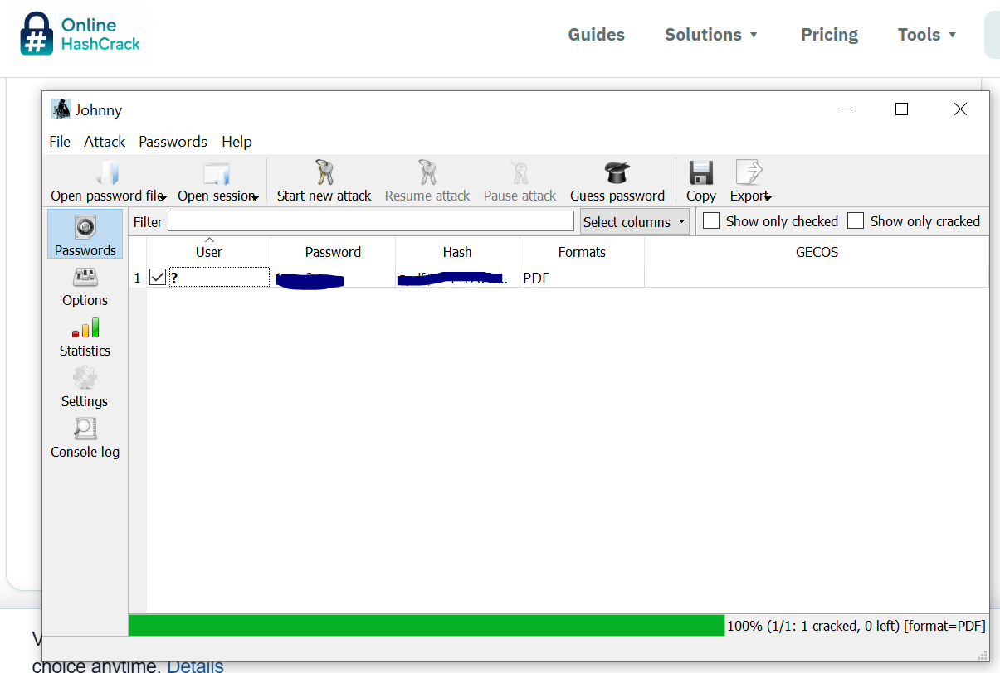
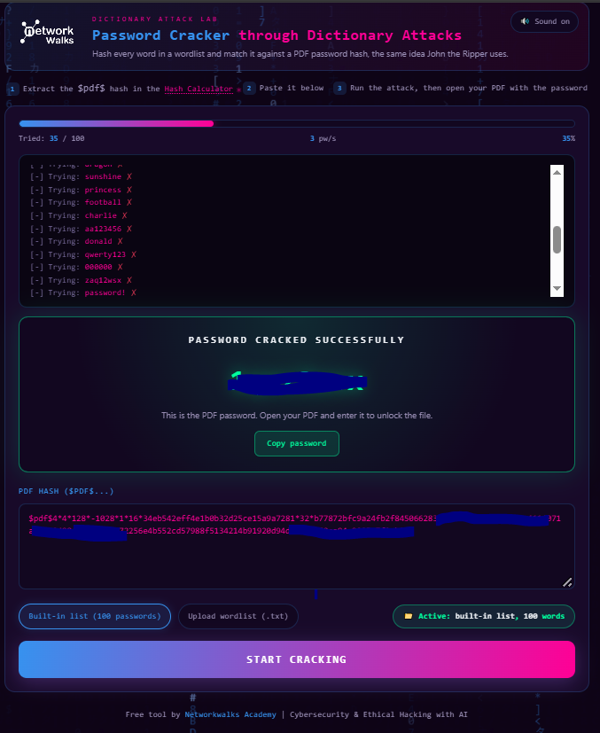
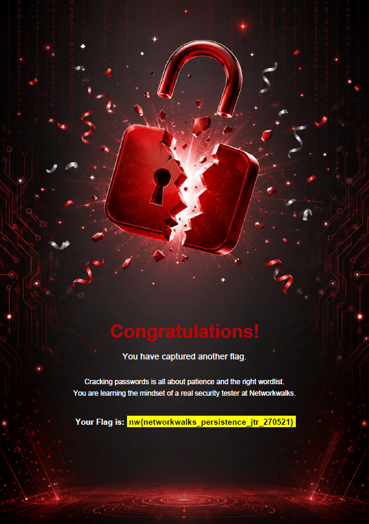

# Week 3 – Password Cracking & Hash Analysis

**NetworkWalks Cybersecurity Internship | Batch 084**

## Overview

During Week 3, We explored password cracking techniques using **Johnny GUI, and NetworkWalks security tools**.

These hands-on labs helped me better understand how password protection works, how hashes are used in password recovery, and why weak passwords represent a security risk.

## Key Learnings

- **Hashing vs. Encryption:** Solidified my understanding of the differences between hashing and encryption and their roles in data security.
- **Password Hash Analysis:** Learned how to extract and analyze password-related data from protected PDF files.
- **Password Cracking Techniques:** Gained hands-on experience recovering passwords from protected PDF files using Johnny GUI and NetworkWalks' dictionary-based password cracking tool.
- **Password Security:** Understood how password complexity and predictability affect resistance to password cracking attacks.

## Tools Used

- Johnny GUI
- NetworkWalks Hash Calculator
- NetworkWalks Password Cracker

## Conclusion

These exercises helped me connect theoretical cybersecurity concepts with practical security testing.

My main takeaway is that **password protection is only as strong as the passwords and security mechanisms supporting it**. Understanding how password cracking works is valuable for identifying weaknesses, evaluating security risks, and recommending stronger authentication practices.

## Lab Evidence

*Screenshots of the lab activities and results will be included below.*

